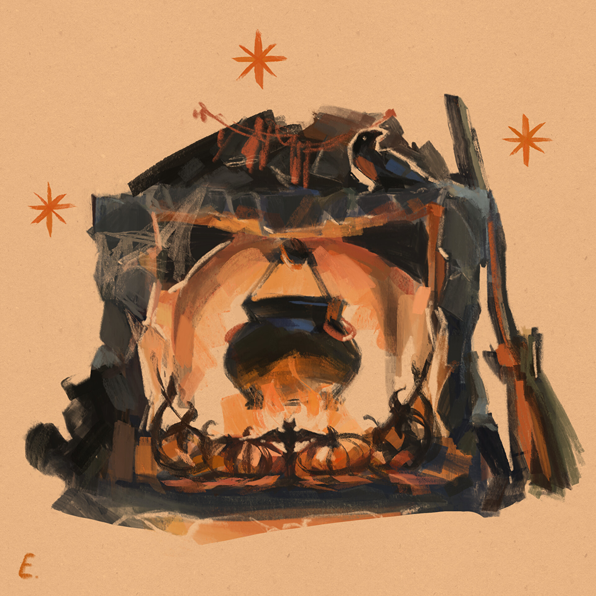

# Тот Самый Суп

Иллюстрация обложки © **[Elena Kravets](https://www.artstation.com/elenamikhailova)**.

Приключение для **Foundry VTT 14.369** и **dnd5e 6.0.0**. Для 3–5 персонажей 4-го уровня, на 4–5 часов. Игровые правила и авторские существа сохранены по редакции 2014 года. Дополнительные модули не требуются.

## Установка

При скачивании репозитория через **Code → Download ZIP** переименуйте распакованную папку `tot-samyi-sup-main` в `tot-samyi-sup`, затем выполните шаги ниже.

1. Распакуйте архив. Поместите папку `tot-samyi-sup` в папку `Data/modules` вашего каталога пользовательских данных Foundry. Файл должен оказаться по адресу `Data/modules/tot-samyi-sup/module.json`.
2. Перезапустите Foundry. Откройте мир с системой dnd5e 6.0.0.
3. В управлении модулями включите **Тот Самый Суп**.
4. Откройте **Компендии → Тот Самый Суп · Приключение**. Откройте запись приключения и нажмите **Импортировать приключение**.
5. Откройте журнал **00 · Начните здесь**. В папке макросов запустите **Панель ведущего** и перетащите этот макрос на панель быстрого доступа.
6. Нажмите **Диагностика**. Она проверит документы настоящими схемами вашей версии Foundry и отправит отчёт только ведущим.

Это локальная установка из ZIP. Публичный адрес manifest для установки по ссылке не создан.

## Содержимое

- 20 листов: все авторские ингредиенты, Шкварка, шесть соперников, трое судей, Малуша после финала и шаблон призрака игрока.
- 19 предметов: продукты с состояниями, половник, инструменты повара, договор и банка памяти. Кость представлена только испорченной.
- 30 страниц журналов: весь исходный текст, описание зон, материалы игрокам и руководство ведущего.
- Основная сцена с картой без подписей, 20 перенесёнными стенами, 47 источниками света и шестью журнальными точками.
- Три тактические сцены кладовой 90×60 футов: Закуска, Горячее, Финал.
- Оригинальные векторные токены, три макроса и две справочные таблицы.
- Панель туров, учёт добычи и краж, броски готовки, результаты, соперники, призраки и напоминания действий логова.

## Начало игры

Создайте или импортируйте персонажей игроков. В панели выберите их, размер группы, уровень и текущий тур. Нажмите **Сохранить настройки**, затем **Подготовить сцену**. Персонажи на сценах связаны со своими исходными листами; хиты и ресурсы сохраняются между турами.

Размер группы и уровень задают сложность при первой подготовке сцены. У уже подготовленной сцены модуль не сбрасывает хиты существ и не пересчитывает состав. **Создать бой** добавляет участников в трекер; инициативу и начало боя запускайте обычными кнопками Foundry. После десяти завершённых раундов панель напоминает, что песок кончился. Она не завершает бой принудительно.

После добивающего удара выберите токен ингредиента и нажмите **Зафиксировать добычу**. Введите хиты **до удара вместе с временными**, фактический урон **после сопротивлений и иммунитетов** и типы урона, вызывающие порчу. Отметьте, лежит продукт на полу, подобран героями или унесён соперниками. Подбор, дистанцию 5 футов и взаимодействие с предметом контролирует ведущий. Порча фиксируется один раз; менять можно владельца.

Укажите владение **инструментами повара** в листе повара. Готовка вызывает штатную проверку Мудрости с этими инструментами: система учитывает владение, состояния и особенности. Панель добавляет штрафы продуктов и бульон; Помощь отмечается в окне выбора блюда. Для блюда выбираются конкретные продукты, лишняя добыча не обязана использоваться. Обычный тур нельзя перебрасывать. В финале реализована одна повторная готовка из тех же ингредиентов при результате «Почти». Ошибочную последнюю запись можно отменить кнопкой **Исправить последнюю оценку**.

Для боя с хозяйкой есть отдельная кнопка **Бой со Шкваркой**. Она открывает основную сцену, переносит группу, создаёт бой и задаёт Шкварке 90, 112 или 140 хитов по сложности. Повторное нажатие открывает уже созданный бой, сохраняя его состояние.

## Что остаётся ведущему

Захваты, состояния и их окончание, перемещение в котёл, смерть, воскрешение, реакции, укрытия, преимущество Ненасытной и действия логова требуют решения ведущего. Листы содержат нужные атаки, урон, спасброски и русский текст. Автоматического применения всех последствий и интеграции с Midi-QOL нет.

Панель создаёт отдельный лист призрака с правами владельцев исходного персонажа, но не изменяет исходные хиты и состояние. Игрок продолжает играть за призрака у судейского стола. Возврат воспоминания сам по себе не воскрешает. При правильном супе верните попавшим в котёл **этой ночью** 1 хит и добавьте одну степень истощения вручную на рассвете. Призраки прошлых лет уходят, а не воскресают.

Сброс учёта очищает только состояние панели. Для полностью новой игры используйте новый мир и импорт приключения. Штатный повторный импорт в текущий мир может заменить изменённые документы.

## Уточнения при переносе

Фиксированные результаты соперников сохранены: 15/13/10 и 15/(13 + 2 за украденный продукт)/16. Их бульон не прибавляется к этим числам повторно. При ничьей панель запрашивает число испорченных и недостающих продуктов соперников: источник его не задаёт. Намеренный провал обычного тура получает технический результат 0 для сравнения мест; в финале числовое значение не требуется. Если смешанный добивающий удар содержит кислоту, некротическую энергию или яд, он считается портящим. Дополнительная луковая стая при усиленной сложности даёт запасной лук, а не пятый обязательный продукт финала.

